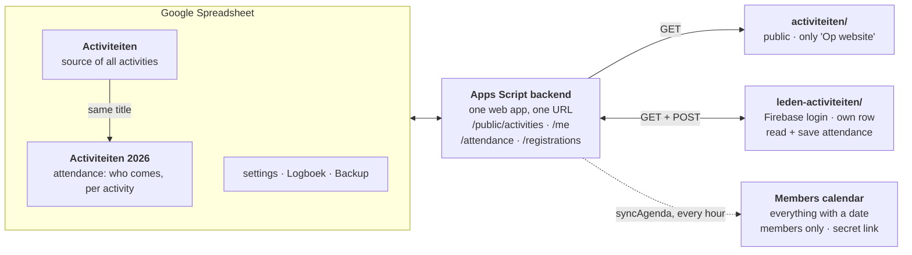

# Muziekvereniging Steenbrugge

One spreadsheet, one backend, three outputs: a public activities page, the members page where musicians fill in their attendance, and a members calendar.

| Folder | What |
|---|---|
| `activiteiten/` | Public page with the upcoming activities (no login), can also be embedded in another website |
| `leden-activiteiten/` | Members page: PWA with swipe cards, login via Firebase |
| `apps-script/` | The backend (Google Apps Script): the code in `src/`, with `local/` (simulation + local server) and `test/` |
| `api-docs/` | `openapi.yaml`: description of the API |
| `img/` | Shared images (the icon used by both pages) |

Spreadsheet names (tabs, column titles, settings labels) and everything users see on the pages stay Dutch; the pages also have an English version (see [Languages](#languages)). Code, comments, the API and this README are English.

## Who reads what

The secretary only works in the spreadsheet. The backend reads from it and gives each output only what it may see: the website never gets member data, the members page only gets the row of whoever is logged in.



Solid arrow: a page requests something. Dashed arrow: the backend writes to the calendar itself, through a time-driven trigger.

**Login:** Firebase remembers the login until the user logs out. Every request from the members page sends the Firebase ID token along (`?idToken=`). The backend has Google verify that token and only works with the email address from it, and only if that address is **verified**. Anyone can create a Firebase account with any address; only verification shows it belongs to that person. When registering, the member gets a mail to set their password, and that verifies the address. Without verification: `EMAIL_NOT_VERIFIED`. Only the registration notice to the secretary works without it. After that the address must be on the member list (otherwise `NOT_A_MEMBER`); `Alleen-lezen` decides whether the member may also change answers.

## Setting up the spreadsheet

### Tab `Activiteiten`

One row per activity. The backend looks for the row with the column titles in the first 5 rows (the row that contains `Titel`) and finds the columns by that title, so the order is free. `Titel` and `Start` are required.

| Column | Who | Content |
|---|---|---|
| `Titel` | formula or secretary | Must equal the column title in the attendance sheet (case, line breaks and double spaces are ignored). Easiest as a formula, e.g. `='Activiteiten 2026'!D6`; a rename then follows automatically. |
| `Start`, `Locatie` | secretary | `Start` is date + time. Empty = "date to be announced". |
| `Eind` | secretary | Time (`22:00`) or full date. Empty = 2 hours after the start. |
| `Op website` | secretary | Checkbox: shown on the public page. |
| `Op LedenActiviteiten` | secretary | Checkbox: members see this activity on the members page and can fill in their attendance. See below. |
| `Beschrijving website`, `Beschrijving LedenActiviteiten` | secretary | Dutch description. Formatting and links are carried over. |
| `Beschrijving website EN`, `Beschrijving LedenActiviteiten EN` | secretary | Optional English description. Empty = the English page shows the Dutch one. |
| `Agenda-ID`, `Agenda-status`, `Agenda-vingerafdruk` | script | Managed by `syncAgenda`; you may hide them. |

### Attendance tab (`Activiteiten 2026`)

The name of this tab is in `settings!F2`; always one year, e.g. `Activiteiten 2026`. The secretary makes the columns, as before; no job changes this sheet. A column belongs to the row in `Activiteiten` with the same title. Closing an activity stays manual, with the J row.

**Who sees what on the members page.** `Op LedenActiviteiten` works as an access list. A column of the attendance sheet only shows on the members page if there is an activity with the same title and it is ticked. Everything else stays hidden and cannot be filled in, not even directly through the API:
- an activity with `Op LedenActiviteiten` unticked;
- a column without an activity of the same title (also after a typo in the title).

So a new activity only shows on the members page once it has a row in `Activiteiten` and is ticked. The members calendar and the score ignore the checkbox: they contain everything.

As long as `Activiteiten` has no `Op LedenActiviteiten` column (or is not set up yet), the members page shows all columns. **During the switch:** first tick what members should see, and only then upload the backend; otherwise those activities disappear immediately. The local server shows at startup which columns are hidden; in the editor, `hiddenColumns` gives the same list.

### Settings in `settings`

The secretary sets these values in the `settings` tab: type the label in a cell and the value in the cell **to the right** of it (where does not matter). An empty value falls back to the Script Property with the same meaning.

| Label | Value | Script Property (fallback) |
|---|---|---|
| `Agenda-ID` | ID of the members calendar | `CALENDAR_ID` |
| `Agenda-link` | Secret iCal address; the members page shows it after login | `AGENDA_ICAL_URL` |
| `Mail nieuwe accounts` | Gets a mail when someone creates an account | `NOTIFY_EMAIL` |

`SHEET_ID` and `FIREBASE_API_KEY` stay Script Properties: the script needs them before it can read the spreadsheet.

### Column filter on the attendance sheet

For the secretary, in the attendance tab: the `ReadOnlyToggle` cell (a named range) switches the filter on or off. In the row above the column titles, one column after the last activity, there is the filter text (only columns whose title contains it stay visible) and next to it a checkbox to also hide closed activities (J). Both work together. `onFilterEdit` only reacts to those cells and the J row, and changes the columns in blocks instead of one by one.

### Members calendar

Every activity with a date goes in; without a date it does not. `syncAgenda` creates, updates and deletes events according to the sheet and writes the `Agenda-status` (`Nog te plannen`, `Klaar om te plannen`, `Gewijzigd`, `Gepland`). Whatever you change directly in the calendar on such an event is overwritten at the next sync. Events you add to the calendar yourself are left alone. Calendar events always use the Dutch title and description.

1. In Google Calendar (with the account that runs the script), create a calendar, e.g. "Muziekvereniging Steenbrugge". Do **not** share it publicly.
2. Settings of that calendar → *Integrate calendar*: put the **Calendar ID** in `Agenda-ID` and the **secret address in iCal format** in `Agenda-link` in `settings`.
3. If the link leaks: create a new secret address in the same settings and replace `Agenda-link`.
4. Choosing another calendar: the next sync puts everything in the new calendar. You delete the events in the old calendar yourself.

## Languages

Both pages are available in Dutch and English.

- **Members page:** a `?lang=nl` or `?lang=en` URL parameter wins; otherwise the choice made earlier with the `NL | EN` toggle (on the login screen and above the list); otherwise the browser language (Dutch if the browser prefers Dutch, English otherwise). The switch is remembered in `localStorage` (`langSteenbrugge`).
- **Public page:** always Dutch, without a switch and without browser detection. Only `?lang=en` (or `data-lang="en"` on the embed) shows the English texts.
- Dates and times are formatted in the chosen language.
- **Page texts:** one `nl` and one `en` dictionary per page, in `leden-activiteiten/i18n.js` and `activiteiten/i18n.js`. A new text goes in both.
- **Spreadsheet content:** activity titles and locations are the same in both languages. Descriptions come from the optional `... EN` columns (see above); empty falls back to Dutch.
- **Errors:** the API returns English messages meant for developers. The pages show their own text per error `code`.
- **Not translated:** the registration mail and the backup mail to the secretary, and the members calendar.

## Activities on another website

Paste this where the list should appear:

```html
<div data-steenbrugge-activiteiten data-limit="5"></div>
<script src="https://<this site>/activiteiten/embed.js" async></script>
```

`embed.js` places an iframe that sizes itself to the right height: no scrollbar, transparent background, no title. Links open in a new tab.

| Attribute | Values |
|---|---|
| `data-limit` | Maximum number of activities. A link to the full list is added below. Empty = all. |
| `data-lang` | `nl` (default) or `en`. |

If the website does not allow scripts (some site builders), use a plain iframe with a fixed height: `<iframe src="https://<this site>/activiteiten/?embed=1&limit=5" style="width:100%;height:600px;border:0"></iframe>`. The same parameters also work on the standalone page, e.g. `/activiteiten/?lang=en`.

## Testing locally (2 servers)

```bash
# 1. backend: runs the real Apps Script code on your spreadsheet or the example spreadsheet
cd apps-script
cp .env.example .env              # once, fill in FIREBASE_API_KEY
npm install                       # once, only needed to read your own .xlsx
node local/server.mjs --fake-auth # http://localhost:8787/exec

# 2. frontend (second terminal, from the root of the repo)
python3 -m http.server 5500
```

- **Members page:** http://localhost:5500/leden-activiteiten/?debug=1
- **Public page:** http://localhost:5500/activiteiten/?debug=1

In the debug bar at the bottom, pick the local backend (`localhost:8787`) and save. That choice applies to both pages, and only with `?debug=1` in the URL; without it they always use production (`PRODUCTION_API` at the top of each page). The debug bar only exists on `localhost`/`127.0.0.1`: online, `?debug=1` does nothing.

- **Your own spreadsheet:** in Google Sheets *File → Download → Microsoft Excel (.xlsx)*, and put the file in `apps-script/local/data/` (git ignores that folder: it contains member data). The server takes the newest `.xlsx` there, or the file from `--xlsx <path>` or `LOCAL_XLSX` in `.env`. At startup it reports whether the code can read your spreadsheet. Values, dates, formatted text, links and cell colours are carried over. Formulas are not recalculated: the score stays the one from the export, even after saving. With `--example` you use the example spreadsheet anyway (`--voorbeeld` still works).
- **Logging in:** the members page uses the real Firebase. With your own spreadsheet you log in with an account that is in it. With the example spreadsheet, put your email address in `.env` under `LOCAL_MEMBERS=`; otherwise you get `NOT_A_MEMBER`.
- **Example spreadsheet:** attendance tab `Activiteiten 2026`, members `piet@example.com`, `an@example.com` (read-only) and `jan@example.com`. Activities with and without a date, an activity without `Op LedenActiviteiten`, a column (`Oud concert`) without an activity, which is therefore hidden, and a few English descriptions.
- **Memory:** what you save stays until you restart the server; the file itself is never changed.
- **Changing code:** changes in `apps-script/src/*.js` apply at the next request, without a restart.
- **Calendar:** `curl -X POST localhost:8787/local/agenda/sync` runs `syncAgenda` on a fake calendar; `curl localhost:8787/local/agenda` shows the events.
- **Without Firebase:** with `--fake-auth`, `dev:<email>` counts as a token with a verified address, `dev-unverified:<email>` as one with an unverified address:
  ```bash
  curl "localhost:8787/exec/me?idToken=dev:piet@example.com"
  curl -X POST "localhost:8787/exec/attendance?idToken=dev:piet@example.com" -d '{"id":"concert-in-de-kerk","answer":"X"}'
  ```
- **Service worker:** does not run on `localhost`, so you always see the latest code.

## API

The full description is in `api-docs/openapi.yaml`. Get a real token for `curl` in the browser console of the locally opened members page (`localhost:5500/leden-activiteiten/?debug=1`, logged in): `await getIdToken()`. Locally with `--fake-auth`, `dev:<email>` is enough.

Apps Script quirks, also described in the spec:
- Every response is HTTP 200; whether it worked is in `{ ok, data | error }`.
- Do not send your own headers: Apps Script does not answer a CORS preflight.
- POST bodies are JSON, sent as `text/plain`.
- Activity ids are derived from the column title (`Concert in de kerk` → `concert-in-de-kerk`; `column-<nr>` for an empty title).

## Tests

```bash
cd apps-script && node --test
```

They run the real code on the example spreadsheet. Covered:
- login, the token cache and unverified addresses
- public list: filter, sorting, cache, no member data, English descriptions
- linking by title and `Op LedenActiviteiten` as access list: unticking, renaming, a column without an activity, no `Op LedenActiviteiten` column
- saving answers and the refusals (closed, read-only, `-`)
- registration mail and escaping html
- calendar status on a change (`onActivitiesEdit`)
- settings from `settings`, and a tab `Activiteiten` that is not set up yet
- reading your own `.xlsx` (after `npm install`; skipped otherwise)
- `syncAgenda`: create, update, recreate, clean up
- column filter: filter text and closed activities together, hiding in blocks, only reacting to the filter cells

## To production

Once:
1. `cp apps-script/.clasp.json.example apps-script/.clasp.json`, fill in the `scriptId` and run `clasp login`.
2. In the Apps Script editor under **Project Settings → Script Properties**, set `SHEET_ID` and `FIREBASE_API_KEY`. `Agenda-ID`, `Agenda-link` and `Mail nieuwe accounts` go in the `settings` tab (see above).
3. Set up the spreadsheet as above and tick `Op LedenActiviteiten` for what members should see.
4. Check in the Firebase console (*Authentication → Users*) whether existing accounts have a verified address. Anyone without one gets `EMAIL_NOT_VERIFIED` until they set a new password via *Wachtwoord vergeten* / *Forgot password*.
5. In the editor, run `installAgendaTriggers` and `installFilterTriggers` once each and approve the access (calendar, external requests). `installAgendaTriggers` sets `syncAgenda` every hour, and `onActivitiesEdit` on every change (calendar status); `installFilterTriggers` sets `onFilterEdit` on every change (column filter on the attendance sheet, see above). Each one only replaces its own triggers, so running it again never makes doubles. To sync right away, run `syncAgenda` from the editor.

**After upgrading from an earlier version:** run both once more. `installAgendaTriggers` removes the triggers with the old Dutch names (`onActiviteitenEdit`, `toonMenu`, and those of `installTriggers`/`installeerTriggers`), `installFilterTriggers` removes a hand-made `onChange` trigger of the old column filter.

Every release:
```bash
cd apps-script
node --test                     # must be green
clasp status                    # shows what will be pushed (only what is in src/)
clasp push
clasp redeploy <deploymentId> -d "description"   # deploymentId = the AKfycb... part of the URL
```

`redeploy` keeps the same URL. With every release of the members page, also bump `VERSION` in `leden-activiteiten/sw.js`. The old addresses `/LedenActiviteiten/` and `/LedenLogin/` no longer exist: anyone who had the members page as an app on their phone adds `/leden-activiteiten/` again.

## Troubleshooting

| Symptom | Cause |
|---|---|
| Debug bar *Test* cannot reach the backend | Backend not running, or the URL does not end in `/exec` |
| Every request gives `UNAUTHENTICATED` | `FIREBASE_API_KEY` missing or wrong, or the key is restricted to certain websites in Google Cloud (the check happens from the server) |
| `NOT_A_MEMBER` | The email address is not in the email column of the attendance sheet. Locally with the example spreadsheet: not in `LOCAL_MEMBERS` |
| `EMAIL_NOT_VERIFIED` | The member never set their password via the mail. Have them use *Wachtwoord vergeten* / *Forgot password* |
| Activity not on the members page | `Op LedenActiviteiten` unticked, the title in `Activiteiten` differs from the column title in the attendance sheet, or there is no column in the attendance sheet. `hiddenColumns` (editor) or the local server startup shows which columns are hidden |
| Activity not on the website | `Op website` unticked, or the end has passed. The list is cached for 10 minutes |
| English page shows the Dutch description | The `... EN` column is empty for that activity, or its title differs from the table above |
| `Agenda-status` stays `Klaar om te plannen` | `installAgendaTriggers` not run or `Agenda-ID` wrong; check *Executions* in the editor |
| `Activiteiten is not set up yet, missing: column 'Titel' ...` | The column titles in `Activiteiten` (in one of the first 5 rows) differ from the table above |
| CORS error in the console | A header is sent (e.g. `Authorization`) or a body as `application/json`. The local server refuses a preflight just like Apps Script (405) |
| Old version stays visible (online) | The service worker caches everything: bump `VERSION` in `sw.js`, or clear it in DevTools via Application → Storage |
